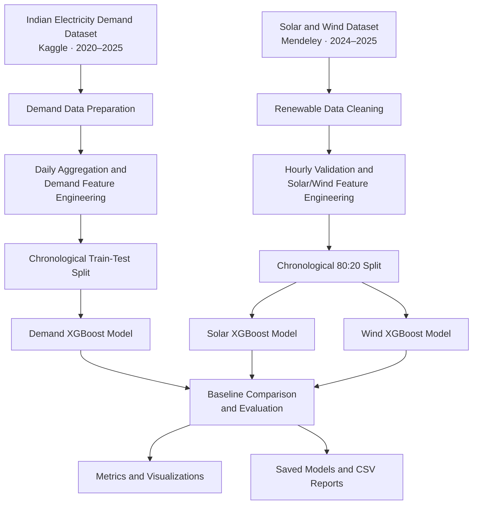
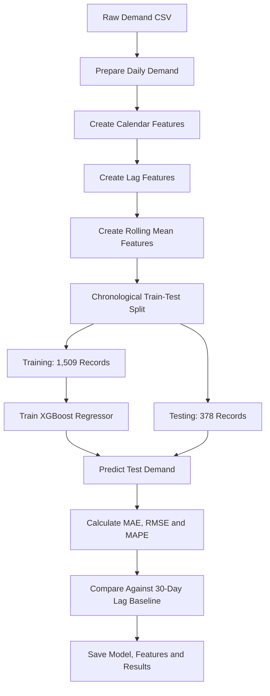
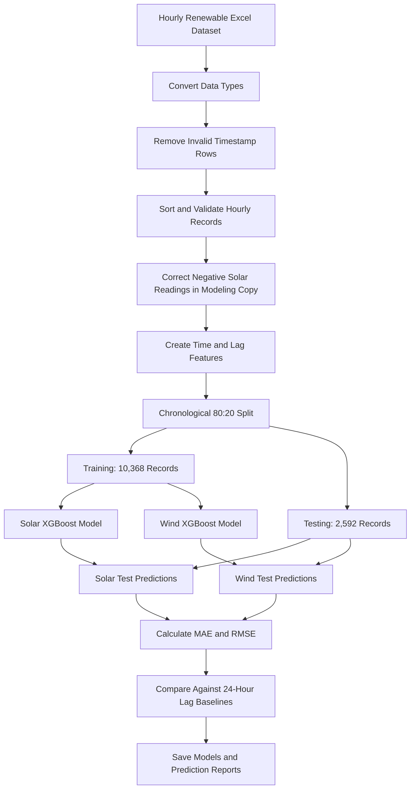

# Member 1 — Electricity Demand, Solar & Wind Forecasting

## 1. Overview

This section documents my contribution to the Energy Forecasting project. I developed three machine-learning forecasting models:

1. **Electricity Demand Forecasting** — daily demand prediction.
2. **Solar Generation Forecasting** — hourly solar power prediction.
3. **Wind Generation Forecasting** — hourly wind power prediction.

The workflow covers dataset selection, data cleaning, exploratory analysis, feature engineering, model training, testing, baseline comparison, evaluation, and saving the trained models and reports.

**Model used:** XGBoost Regressor  
**Language:** Python  
**Libraries:** Pandas, NumPy, Matplotlib, Scikit-learn, XGBoost, Joblib, OpenPyXL

---

## 2. Datasets Used

### Dataset 1: Indian Electricity Demand

- **Source:** [Kaggle — Indian Power Demand and Shortage Data (2020–2025)](https://www.kaggle.com/datasets/preygle/indian-power-demand-and-shortage-data-2020-2025)
- **Local file:** `Data/India_Elec_data_(Jan2020-Mar2025).csv`
- **Period:** January 2020 – March 2025
- **Raw dataset shape:** 69,012 rows × 9 columns
- **Prepared forecasting dataset:** 1,887 daily records

This dataset was used to build a daily electricity demand forecasting model.

### Dataset 2: Solar and Wind Generation

- **Source:** [Mendeley Data — Electricity Demand, Solar and Wind Generation Data](https://doi.org/10.17632/y58jknpgs8.2)
- **Local file:** `Data/January 2024- June 2025.xlsx`
- **Data used:** January 2024 – June 2025
- **Time interval:** Hourly
- **Cleaned dataset shape:** 12,984 rows × 5 columns

The dataset contains:

- `Timestamp`
- `Demand (MW)`
- `Wind (MW)`
- `Solar (MW)`
- `Total Generation (MW)`

This dataset was used to develop separate hourly solar and wind generation forecasting models.

---

## 3. Project Architecture and Workflow

The following diagram summarizes my complete workflow.



---

## 4. Demand Forecasting — Data Preparation

### 4.1 Data preparation

The original demand data contained 69,012 rows and nine columns. It was processed into a daily forecasting dataset containing 1,887 records.

The preparation work included:

- Preparing daily demand records from the original dataset.
- Organizing the data by date.
- Creating calendar-based features.
- Creating historical demand lag features.
- Creating rolling-average demand features.
- Preparing the final feature matrix for model training.

**Data-quality limitation:** Some state-level demand records were missing. The prepared daily demand data included imputed values for some missing records. This can affect the resulting aggregate demand values and should be considered when interpreting predictions.

### 4.2 Feature engineering

The following features were created:

| Feature group | Features |
|---|---|
| Calendar | `year`, `month`, `day` |
| Calendar | `day_of_week`, `day_of_year`, `week_of_year` |
| Historical demand | `lag_1`, `lag_7`, `lag_14`, `lag_30` |
| Rolling averages | `rolling_mean_7`, `rolling_mean_14`, `rolling_mean_30` |

Lag features represent previously observed demand. Rolling means were calculated using `Demand.shift(1)` before calculating the rolling average, avoiding the inclusion of the current day's target in its rolling features.

### 4.3 Demand forecasting architecture



---

## 5. Demand Forecasting — Training and Testing

### Model configuration

| Parameter | Value |
|---|---:|
| Algorithm | XGBoost Regressor |
| `n_estimators` | 300 |
| `max_depth` | 5 |
| `learning_rate` | 0.05 |
| `random_state` | 42 |
| Objective | `reg:squarederror` |
| Training records | 1,509 |
| Testing records | 378 |

The dataset was split chronologically instead of randomly, so the test set represents a later period than the training set.

### Demand model results

The XGBoost model was compared with a simple baseline that uses demand from 30 days earlier.

| Evaluation metric | Baseline | XGBoost |
|---|---:|---:|
| MAE | 11,631.25 MW | 5,193.60 MW |
| RMSE | 14,840.31 MW | 6,929.60 MW |
| Improvement in MAE | — | 55.35% |
| Improvement in RMSE | — | 53.31% |

The model also achieved a reported MAPE of **2.26%**.

**Interpretation:** On the held-out test set, XGBoost performed better than the 30-day lag baseline on both MAE and RMSE.

### Demand feature importance

The ten most important features were:

| Rank | Feature | Importance |
|---:|---|---:|
| 1 | `lag_1` | 0.4792 |
| 2 | `rolling_mean_7` | 0.2133 |
| 3 | `rolling_mean_14` | 0.1835 |
| 4 | `lag_7` | 0.0351 |
| 5 | `day_of_week` | 0.0195 |
| 6 | `week_of_year` | 0.0177 |
| 7 | `rolling_mean_30` | 0.0125 |
| 8 | `day_of_year` | 0.0109 |
| 9 | `year` | 0.0095 |
| 10 | `lag_14` | 0.0058 |

The top three features account for approximately **87.60% of total feature importance**. Recent demand and short-term rolling averages were the strongest predictors in this trained model.

### Prediction interface validation

The saved demand prediction function was tested successfully with a valid feature row:

- Predicted demand: **228,665.03 MW**
- Actual demand: **231,218.00 MW**
- Absolute error: **2,552.97 MW**

This is one example prediction, not the overall model evaluation. The overall test metrics are reported in the table above.

---

## 6. Solar and Wind Forecasting — Data Cleaning

### 6.1 Initial inspection

The Excel dataset initially contained mixed data types because numeric measurements and summary-statistics rows were present in the same worksheet.

The cleaning workflow included:

1. Loading the `Report` worksheet using Pandas and OpenPyXL.
2. Converting `Timestamp` into a datetime data type.
3. Converting demand, wind, solar, and total generation columns into numeric values.
4. Removing rows with invalid timestamps, including six non-observation summary rows.
5. Sorting records by timestamp.
6. Checking for missing values and duplicate timestamps.
7. Checking whether timestamps were continuous at hourly intervals.
8. Creating a separate modeling copy for solar-value correction.

### 6.2 Cleaning results

| Validation | Result |
|---|---|
| Rows after timestamp cleaning | 12,984 |
| Missing values after cleaning | 0 |
| Duplicate timestamps | 0 |
| First timestamp | 2024-01-01 00:00 |
| Last timestamp | 2025-06-24 23:00 |
| Expected hourly intervals | 12,983 |
| Actual hourly intervals | 12,983 |
| Missing hourly intervals | 0 |

### 6.3 Handling negative solar readings

The cleaned source data contained **499 negative solar readings**. Negative solar generation is not physically meaningful, so these readings were set to zero in a separate modeling copy.

```python
renewable_clean = renewable_df.copy()

negative_count = (renewable_clean["Solar (MW)"] < 0).sum()

renewable_clean.loc[
    renewable_clean["Solar (MW)"] < 0, "Solar (MW)"
] = 0
```

This correction was applied to the modeling copy, leaving the original cleaned source dataframe unchanged. It is a documented modeling assumption rather than a verified explanation for the source anomalies.

---

## 7. Solar and Wind Forecasting — Feature Engineering

Separate models were developed for solar and wind generation.

### Features created

| Feature | Purpose |
|---|---|
| `hour` | Captures the hour of the day |
| `day_of_week` | Captures weekly patterns |
| `month` | Captures monthly patterns |
| `day_of_year` | Captures annual seasonal patterns |
| `Solar (MW)_lag_1` | Previous hour's solar generation |
| `Solar (MW)_lag_24` | Solar generation 24 hours earlier |
| `Wind (MW)_lag_1` | Previous hour's wind generation |
| `Wind (MW)_lag_24` | Wind generation 24 hours earlier |

After creating lag features and removing rows without sufficient lag history, the feature-engineered dataset contained **12,960 rows and 13 columns**.

The input features did not include the current-hour solar or wind target. `Total Generation (MW)` was also excluded from the model inputs.

### Renewable forecasting architecture



### Train-test split

| Split | Records | Period |
|---|---:|---|
| Training | 10,368 | 2024-01-02 00:00 to 2025-03-08 23:00 |
| Testing | 2,592 | 2025-03-09 00:00 to 2025-06-24 23:00 |

The split preserved chronological order to evaluate the models on later observations.

---

## 8. Solar and Wind Forecasting — Training and Testing Results

Both models used XGBoost Regressor with 300 estimators, maximum depth 5, learning rate 0.05, random state 42, and squared-error regression.

The baseline predicts generation using the value from 24 hours earlier.

### Solar generation results

| Metric | 24-hour lag baseline | XGBoost |
|---|---:|---:|
| MAE | 1,292.58 MW | 1,036.57 MW |
| RMSE | 4,262.05 MW | 1,996.19 MW |

After clipping negative solar predictions to zero:

- Final MAE: **1,036.57 MW**
- Final RMSE: **1,996.19 MW**
- Negative predictions remaining: **0**

Compared with the baseline, the corrected model reduced MAE by approximately **19.75%** and RMSE by approximately **53.16%**.

### Wind generation results

| Metric | 24-hour lag baseline | XGBoost |
|---|---:|---:|
| MAE | 2,070.59 MW | 568.81 MW |
| RMSE | 2,709.14 MW | 776.99 MW |

Compared with the baseline, the wind model reduced MAE by approximately **72.53%** and RMSE by approximately **71.32%**.

### Combined results

| Forecasting task | Baseline MAE | XGBoost MAE | XGBoost RMSE |
|---|---:|---:|---:|
| Daily electricity demand | 11,631.25 MW | 5,193.60 MW | 6,929.60 MW |
| Hourly solar generation | 1,292.58 MW | 1,036.57 MW | 1,996.19 MW |
| Hourly wind generation | 2,070.59 MW | 568.81 MW | 776.99 MW |

The baseline and XGBoost results were calculated on their respective test sets. The three tasks have different time intervals and targets, so their error magnitudes should not be compared as if they were the same forecasting problem.

Actual-versus-predicted visualizations were also generated to inspect how well each model followed the observed patterns.

---

## 9. Additional Renewable Energy Analysis

In addition to forecasting, hourly analysis was performed using the cleaned renewable dataset.

Two derived metrics were calculated:

**Estimated residual demand**

```python
renewable_clean["Net Demand (MW)"] = (
    renewable_clean["Demand (MW)"]
    - renewable_clean["Solar (MW)"]
    - renewable_clean["Wind (MW)"]
)
```

**Solar-plus-wind share of demand**

```python
renewable_clean["Renewable Share (%)"] = (
    (
        renewable_clean["Solar (MW)"]
        + renewable_clean["Wind (MW)"]
    )
    / renewable_clean["Demand (MW)"].replace(0, np.nan)
) * 100
```

| Metric | Result |
|---|---:|
| Mean estimated residual demand | 169,491.76 MW |
| Minimum estimated residual demand | 77,474.98 MW |
| Maximum estimated residual demand | 218,515.53 MW |
| Mean solar-plus-wind share of demand | 12.21% |
| Maximum observed solar-plus-wind share | 40.43% |

These are descriptive statistics for the selected dataset. Their interpretation as official national electricity-system measurements depends on confirming that demand and generation have consistent geographic coverage.

---

## 10. Saved Models and Output Files

### Trained models

| File | Purpose |
|---|---|
| `Models/demand_model.pkl` | Trained daily demand forecasting model |
| `Models/solar_model.pkl` | Trained hourly solar forecasting model |
| `Models/wind_model.pkl` | Trained hourly wind forecasting model |

### Feature definitions and prediction interface

| File | Purpose |
|---|---|
| `Models/demand_features.json` | Required input features for the demand model |
| `Models/renewable_features.pkl` | Renewable model feature list |
| `src/predict.py` | Function for generating demand predictions |

### Reports and predictions

| File | Purpose |
|---|---|
| `reports/model_evaluation.csv` | Demand model evaluation |
| `reports/renewable_model_evaluation.csv` | Solar and wind baseline/model comparison |
| `reports/renewable_test_predictions.csv` | Actual and predicted solar and wind test values |
| `reports/hourly_renewable_analysis.csv` | Hourly demand and renewable analysis |
| `reports/renewable_analysis_summary.csv` | Summary statistics for derived metrics |

The actual repository structure should be checked in VS Code to confirm all listed files and folders are present.

---

## 11. Overall Workflow Summary


### Key outcomes

- Prepared a daily electricity demand forecasting dataset from historical Indian power-demand data.
- Trained and evaluated a demand model against a 30-day lag baseline.
- Cleaned and validated an hourly solar and wind dataset.
- Trained separate solar and wind forecasting models.
- Compared both renewable models against 24-hour lag baselines.
- Generated feature importance, actual-versus-predicted visualizations, and evaluation reports.
- Saved the trained models and supporting files for future integration.

**Member 1 contribution:** Data preparation, demand forecasting, solar and wind forecasting, model evaluation, renewable data analysis, and saving trained models and results.

